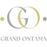
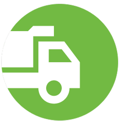
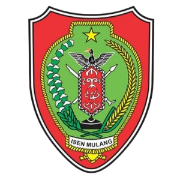
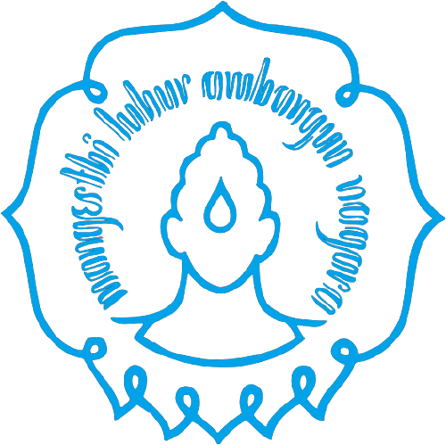

# Hi👋, I’m Bagus Mahmudie

I am a passionate **Full-Stack Web Developer** specializing in blending complex backend logic with modern, dynamic user interfaces. From high-converting corporate company profiles to complex administration dashboards, e-commerce networks, and structural decision support systems, I also develop ready-to-use digital products specifically designed to foster business growth.

🌍 Available for global remote contracts and collaborative software engineering roles. 
⚡ Strong focus on performance optimization, responsive layouts, and clean architecture.

Based in **Jakarta, Indonesia**. Open to remote roles and project collaborations.

## Tech Stack & Tools

  &nbsp;
  &nbsp;
  &nbsp;
  &nbsp;
  &nbsp;
  &nbsp;
  &nbsp;
  &nbsp;
  &nbsp;
  &nbsp;
  &nbsp;
  &nbsp;
  &nbsp;
  &nbsp;
  &nbsp;
  &nbsp;
  &nbsp;
  &nbsp;
  &nbsp;
  &nbsp;
  &nbsp;

## Portfolio

**19 projects · 9 hosted websites · 10 local projects**

Projects are grouped by deployment status and listed from newest to oldest within each group.

### Hosted websites

<table>
  <tr><th>Project</th><th>Overview</th><th>Links</th></tr>
  <tr>
    <td align="center" width="110"></td>
    <td><strong><a href="https://github.com/bagus-mahmudie/uwais-pictures">Uwais Pictures</a></strong> House production website with a film catalogue, news, and Indonesian and English pages.</td>
    <td><a href="https://uwaispictures.id/">Click Here</a></td>
  </tr>
  <tr>
    <td align="center" width="110"></td>
    <td><strong><a href="https://github.com/bagus-mahmudie/grand-ontama">Grand Ontama</a></strong> Residential property website with house types, facilities, articles, and responsive images.</td>
    <td><a href="https://grandontama.com/">Click Here</a></td>
  </tr>
  <tr>
    <td align="center" width="110"></td>
    <td><strong><a href="https://github.com/bagus-mahmudie/eggine-studio">Egginestudio</a></strong> Game studio website featuring games, studio information, and career opportunities.</td>
    <td><a href="https://egginestudio.com/">Click Here</a></td>
  </tr>
  <tr>
    <td align="center" width="110"></td>
    <td><strong><a href="https://github.com/bagus-mahmudie/888living">888Living</a></strong> Architecture, interior design, and renovation website with service and project showcases.</td>
    <td><a href="https://www.888living.id/">Click Here</a></td>
  </tr>
  <tr>
    <td align="center" width="110"></td>
    <td><strong><a href="https://github.com/bagus-mahmudie/mitra-elang-bersatu">Mitra Elang Bersatu</a></strong> Company website for recruitment, outsourcing, and human resource services.</td>
    <td><a href="https://mitraelangbersatu.com/">Click Here</a></td>
  </tr>
  <tr>
    <td align="center" width="110"></td>
    <td><strong><a href="https://github.com/bagus-mahmudie/nymgo">Nymgo</a></strong> Landing page for international calling services and package information.</td>
    <td><a href="https://nymgo.id/">Click Here</a></td>
  </tr>
  <tr>
    <td align="center" width="110"></td>
    <td><strong><a href="https://github.com/bagus-mahmudie/grand-ontama-dashboard">Dashboard Grand Ontama</a></strong> Property administration dashboard for customers, agents, documents, and bookings.</td>
    <td><a href="https://grandontama.com/dashboard/login">Click Here</a></td>
  </tr>
  <tr>
    <td align="center" width="110"></td>
    <td><strong><a href="https://github.com/bagus-mahmudie/drubbix">Drubbix</a></strong> Company website for waste collection, maggot products, and environmental articles.</td>
    <td><a href="https://drubbix.id/">Click Here</a></td>
  </tr>
  <tr>
    <td align="center" width="110"></td>
    <td><strong><a href="https://github.com/bagus-mahmudie/pt-sentral-layanan-prima">PT Sentral Layanan Prima</a></strong> Company website covering outsourcing, recruitment, and facility management services.</td>
    <td><a href="https://pt-slp.co.id/">Click Here</a></td>
  </tr>
</table>

** Grand Ontama Dashboard requires an authorized account.

### Local applications & design studies

Source code is available on GitHub. Live demo are not available for these projects. Setup instructions are included in each repository.

<table>
  <tr><th>Project</th><th>Overview</th><th>Links</th></tr>
  <tr>
    <td align="center" width="110"></td>
    <td><strong><a href="https://github.com/bagus-mahmudie/catkuji">Catkuji</a></strong> Gacha App with event catalogues, prize, draws, inventory, payments, and shipping.</td>
    <td><a href="https://github.com/bagus-mahmudie/catkuji">Source Code</a></td>
  </tr>
  <tr>
    <td align="center" width="110"></td>
    <td><strong><a href="https://github.com/bagus-mahmudie/project-management">Project Management</a></strong> Project management with tasks, comments, attachments, calendars, and daily reports.</td>
    <td><a href="https://github.com/bagus-mahmudie/project-management">Source Code</a></td>
  </tr>
  <tr>
    <td align="center" width="110"></td>
    <td><strong><a href="https://github.com/bagus-mahmudie/auto-trust">Auto Trust</a></strong> Vehicle marketplace for sales and rentals, with seller profiles, favourites, and messaging.</td>
    <td><a href="https://github.com/bagus-mahmudie/auto-trust">Source Code</a></td>
  </tr>
  <tr>
    <td align="center" width="110"></td>
    <td><strong><a href="https://github.com/bagus-mahmudie/lova-dating-site">Lova Dating Site</a></strong> Dating application with user profiles, search, likes, and messaging.</td>
    <td><a href="https://github.com/bagus-mahmudie/lova-dating-site">Source Code</a></td>
  </tr>
  <tr>
    <td align="center" width="110"></td>
    <td><strong><a href="https://github.com/bagus-mahmudie/spk-asrama-kalteng">SPK Asrama Kalteng</a></strong> Dormitory selection decision support system using Simple Additive Weighting (SAW).</td>
    <td><a href="https://github.com/bagus-mahmudie/spk-asrama-kalteng">Source Code</a></td>
  </tr>
  <tr>
    <td align="center" width="110"></td>
    <td><strong><a href="https://github.com/bagus-mahmudie/refactory-redesign">Refactory Redesign</a></strong> An independent landing page redesign study built with HTML, CSS, and JavaScript.</td>
    <td><a href="https://github.com/bagus-mahmudie/refactory-redesign">Source Code</a></td>
  </tr>
  <tr>
    <td align="center" width="110"></td>
    <td><strong><a href="https://github.com/bagus-mahmudie/megah-abadi">Megah Abadi</a></strong> Online store with product catalogues, shopping cart, checkout, payments, and shipping.</td>
    <td><a href="https://github.com/bagus-mahmudie/megah-abadi">Source Code</a></td>
  </tr>
  <tr>
    <td align="center" width="110"></td>
    <td><strong><a href="https://github.com/bagus-mahmudie/sikd-uns">Sistem Informasi Kinerja Dosen (SIKD) UNS</a></strong> Lecturer performance information system for academic activities, research, and reporting.</td>
    <td><a href="https://github.com/bagus-mahmudie/sikd-uns">Source Code</a></td>
  </tr>
  <tr>
    <td align="center" width="110"></td>
    <td><strong><a href="https://github.com/bagus-mahmudie/dishub-uji-berkala">Dishub Uji Berkala</a></strong> Vehicle inspection records with staff access, inspection forms, and document uploads.</td>
    <td><a href="https://github.com/bagus-mahmudie/dishub-uji-berkala">Source Code</a></td>
  </tr>
  <tr>
    <td align="center" width="110"></td>
    <td><strong><a href="https://github.com/bagus-mahmudie/grand-ontama-v1">Grand Ontama V-1</a></strong> The first version Grand Ontama website, retained separately from the hosted redesign.</td>
    <td><a href="https://github.com/bagus-mahmudie/grand-ontama-v1">Source Code</a></td>
  </tr>
</table>

## Get in touch

For any questions, development work or collaboration, reach me on [bagusmahmudie@gmail.com](mailto:bagusmahmudie@gmail.com) or at [LinkedIn](https://www.linkedin.com/in/bagus-mahmudie/).
