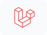
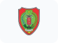
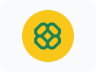
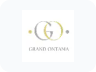

# Hi👋, I’m Bagus Mahmudie

I am a passionate **Full-Stack Web Developer** based in Jakarta, Indonesia. I specialize in bridging intricate backend logic with modern, fluid user interfaces. From high-converting corporate company profiles to complex administration dashboards, e-commerce networks, and structural decision support systems, I also build production-ready digital products tailored for business growth.

- 🌍 Available for global remote contracts and collaborative software engineering roles.
- ⚡ Strong focus on performance optimization, responsive layouts, and clean architecture.

Based in **Jakarta, Indonesia**. Open to remote roles and project collaborations.

## Tech Stack & Tools

  &nbsp;
  &nbsp;
  &nbsp;
  &nbsp;
  &nbsp;
  &nbsp;
  &nbsp;
  &nbsp;
  &nbsp;
  &nbsp;
  &nbsp;
  &nbsp;
  &nbsp;
  &nbsp;
  &nbsp;
  &nbsp;

## Portfolio

**19 projects · 9 hosted websites · 10 local projects**

Projects are grouped by deployment status and listed from newest to oldest within each group.

### Hosted websites

<table>
  <tr><th>Project</th><th>Overview</th><th>Links</th></tr>
  <tr>
    <td align="center" width="110"></td>
    <td><strong><a href="https://github.com/bagus-mahmudie/uwais-pictures">Uwais Pictures</a></strong> Film production website with a film catalogue, news, and Indonesian and English pages.</td>
    <td><a href="https://uwaispictures.id/" target="_blank">Click Here</a></td>
  </tr>
  <tr>
    <td align="center" width="110"></td>
    <td><strong><a href="https://github.com/bagus-mahmudie/grand-ontama">Grand Ontama</a></strong> Residential property website with house types, facilities, articles, and responsive images.</td>
    <td><a href="https://grandontama.com/">Click Here</a></td>
  </tr>
  <tr>
    <td align="center" width="110"></td>
    <td><strong><a href="https://github.com/bagus-mahmudie/eggine-studio">Egginestudio</a></strong> Game studio website featuring games, studio information, and career opportunities.</td>
    <td><a href="https://egginestudio.com/">Click Here</a></td>
  </tr>
  <tr>
    <td align="center" width="110"></td>
    <td><strong><a href="https://github.com/bagus-mahmudie/888living">888Living</a></strong> Architecture, interior design, and renovation website with service and project showcases.</td>
    <td><a href="https://www.888living.id/">Click Here</a></td>
  </tr>
  <tr>
    <td align="center" width="110"></td>
    <td><strong><a href="https://github.com/bagus-mahmudie/mitra-elang-bersatu">Mitra Elang Bersatu</a></strong> Company website for recruitment, outsourcing, and human resource services.</td>
    <td><a href="https://mitraelangbersatu.com/">Click Here</a></td>
  </tr>
  <tr>
    <td align="center" width="110"></td>
    <td><strong><a href="https://github.com/bagus-mahmudie/nymgo">Nymgo</a></strong> Landing page for international calling services and package information.</td>
    <td><a href="https://nymgo.id/">Click Here</a></td>
  </tr>
  <tr>
    <td align="center" width="110"></td>
    <td><strong><a href="https://github.com/bagus-mahmudie/grand-ontama-dashboard">Dashboard Grand Ontama</a></strong> Property administration dashboard for customers, agents, documents, and bookings.</td>
    <td><a href="https://grandontama.com/dashboard/login">Click Here</a></td>
  </tr>
  <tr>
    <td align="center" width="110"></td>
    <td><strong><a href="https://github.com/bagus-mahmudie/drubbix">Drubbix</a></strong> Company website for waste collection, maggot products, and environmental articles.</td>
    <td><a href="https://drubbix.id/">Click Here</a></td>
  </tr>
  <tr>
    <td align="center" width="110"></td>
    <td><strong><a href="https://github.com/bagus-mahmudie/pt-sentral-layanan-prima">PT Sentral Layanan Prima</a></strong> Company website covering outsourcing, recruitment, and facility management services.</td>
    <td><a href="https://pt-slp.co.id/">Click Here</a></td>
  </tr>
</table>

** Grand Ontama Dashboard requires an authorized account.

### Local applications & design studies

Source code is available on GitHub. Public demos are not available for these projects. Setup instructions are included in each repository.

<table>
  <tr><th>Project</th><th>Overview</th><th>Links</th></tr>
  <tr>
    <td align="center" width="110"></td>
    <td><strong><a href="https://github.com/bagus-mahmudie/catkuji">Catkuji</a></strong> Gacha and kuji application with event catalogues, prize draws, inventory, payments, and shipping. Laravel · Vue · Inertia.js · MySQL · Midtrans</td>
    <td><a href="https://github.com/bagus-mahmudie/catkuji">Source</a> Local</td>
  </tr>
  <tr>
    <td align="center" width="110"></td>
    <td><strong><a href="https://github.com/bagus-mahmudie/project-management">Project Management</a></strong> Team project management with tasks, comments, attachments, calendars, and daily reports. Laravel · Vue · Inertia.js · Tailwind CSS · MySQL</td>
    <td><a href="https://github.com/bagus-mahmudie/project-management">Source</a> Local</td>
  </tr>
  <tr>
    <td align="center" width="110"></td>
    <td><strong><a href="https://github.com/bagus-mahmudie/auto-trust">Auto Trust</a></strong> Vehicle marketplace for sales and rentals, with seller profiles, favourites, and messaging. Laravel · Blade · Alpine.js · Tailwind CSS</td>
    <td><a href="https://github.com/bagus-mahmudie/auto-trust">Source</a> Local</td>
  </tr>
  <tr>
    <td align="center" width="110"></td>
    <td><strong><a href="https://github.com/bagus-mahmudie/lova-dating-site">Lova Dating Site</a></strong> Dating application with user profiles, search, likes, and messaging. Laravel · Blade · Bootstrap · MySQL</td>
    <td><a href="https://github.com/bagus-mahmudie/lova-dating-site">Source</a> Local</td>
  </tr>
  <tr>
    <td align="center" width="110"></td>
    <td><strong><a href="https://github.com/bagus-mahmudie/spk-asrama-kalteng">SPK Asrama Kalteng</a></strong> Dormitory selection decision support system using Simple Additive Weighting (SAW). PHP · MySQL · SAW</td>
    <td><a href="https://github.com/bagus-mahmudie/spk-asrama-kalteng">Source</a> Local</td>
  </tr>
  <tr>
    <td align="center" width="110"></td>
    <td><strong><a href="https://github.com/bagus-mahmudie/refactory-redesign">Refactory Redesign</a></strong> An independent landing page redesign study built with HTML, CSS, and JavaScript. HTML · CSS · JavaScript</td>
    <td><a href="https://github.com/bagus-mahmudie/refactory-redesign">Source</a> Local</td>
  </tr>
  <tr>
    <td align="center" width="110"></td>
    <td><strong><a href="https://github.com/bagus-mahmudie/megah-abadi">Megah Abadi</a></strong> Online store with product catalogues, a shopping cart, checkout, payments, and shipping. Laravel · Blade · Tailwind CSS · Midtrans</td>
    <td><a href="https://github.com/bagus-mahmudie/megah-abadi">Source</a> Local</td>
  </tr>
  <tr>
    <td align="center" width="110"></td>
    <td><strong><a href="https://github.com/bagus-mahmudie/sikd-uns">SIKD UNS</a></strong> Lecturer performance information system for academic activities, research, and reporting. Laravel · Blade · MySQL · DataTables</td>
    <td><a href="https://github.com/bagus-mahmudie/sikd-uns">Source</a> Local</td>
  </tr>
  <tr>
    <td align="center" width="110"></td>
    <td><strong><a href="https://github.com/bagus-mahmudie/dishub-uji-berkala">Dishub Uji Berkala</a></strong> Vehicle inspection records with staff access, inspection forms, and document uploads. PHP · MySQL · JavaScript</td>
    <td><a href="https://github.com/bagus-mahmudie/dishub-uji-berkala">Source</a> Local</td>
  </tr>
  <tr>
    <td align="center" width="110"></td>
    <td><strong><a href="https://github.com/bagus-mahmudie/grand-ontama-v1">Grand Ontama V1</a></strong> The original Grand Ontama website, retained separately from the hosted redesign. HTML · Tailwind CSS · JavaScript · PHP</td>
    <td><a href="https://github.com/bagus-mahmudie/grand-ontama-v1">Source</a> Local</td>
  </tr>
</table>

Grand Ontama V1 is the earlier local version; the hosted redesign is listed above. Refactory Redesign is an independent UI study. Project Management uses the Laravel icon already present in its source.

## Get in touch

For development work or collaboration, reach me on [LinkedIn](https://www.linkedin.com/in/bagus-mahmudie/) or at [bagusmahmudie@gmail.com](mailto:bagusmahmudie@gmail.com).
